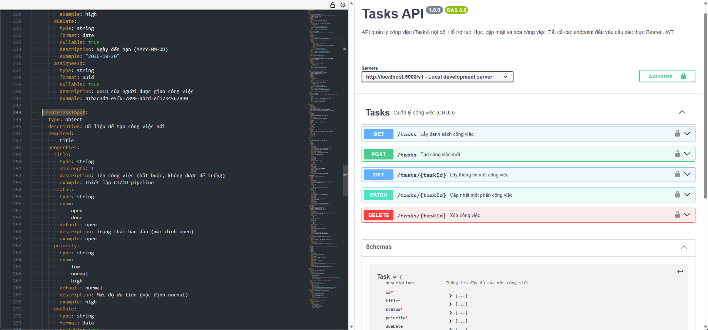
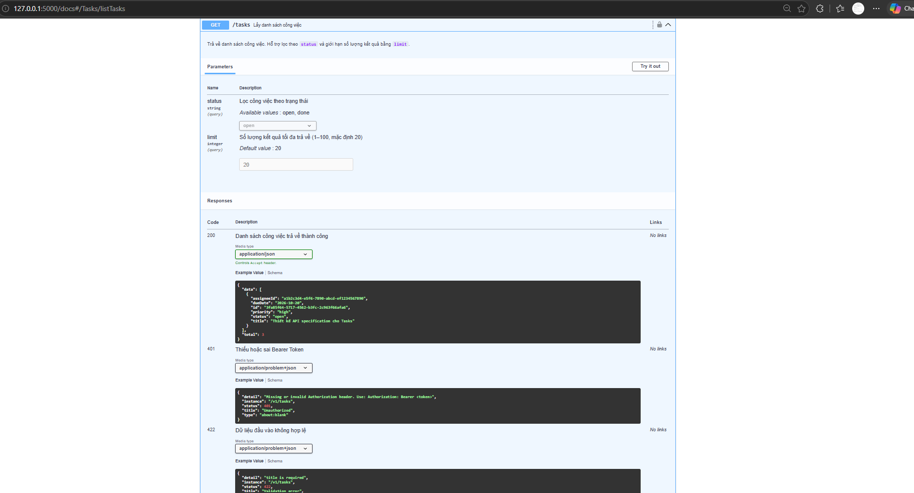

# Tasks API — Quản lý công việc nội bộ

## 1. Giới thiệu

Dự án xây dựng **Tasks API** — một REST API quản lý công việc nội bộ sử dụng Flask (Python), tuân thủ chuẩn **OpenAPI 3.0.3** và các nguyên tắc thiết kế RESTful.

Hệ thống hỗ trợ đầy đủ các thao tác CRUD với công việc, xác thực thông qua **Bearer Token**, phản hồi lỗi chuẩn hóa theo **RFC 7807 (Problem Details)**, cùng giao diện tài liệu tương tác **Swagger UI** tích hợp sẵn.

---

## 2. Công nghệ sử dụng

| Công nghệ | Mục đích |
| :--- | :--- |
| **Python 3.10+** | Ngôn ngữ lập trình chính |
| **Flask 3.x** | Web framework xử lý định tuyến và REST API |
| **PyYAML** | Đọc và chuyển đổi file đặc tả `tasks-api.yaml` |
| **OpenAPI 3.0.3** | Chuẩn mô tả API specification |
| **Swagger UI 5** | Giao diện web trực quan hóa tài liệu và thử nghiệm API |
| **RFC 7807** | Chuẩn định dạng chi tiết lỗi (`application/problem+json`) |

---

## 3. Cấu trúc thư mục

```text
Week4/
├── app.py             # Triển khai Flask API (CRUD, Auth, Swagger UI, /openapi.json, redirect /)
├── tasks-api.yaml     # File đặc tả OpenAPI 3.0.3 hoàn chỉnh
├── requirements.txt   # Danh sách thư viện phụ thuộc (flask, pyyaml)
├── README.md          # Tài liệu hướng dẫn dự án
└── Result_img/        # Hình ảnh kết quả chạy và kiểm thử giao diện
    ├── Test1.png      # Tổng quan giao diện Swagger Editor / Swagger UI và các endpoint
    └── Test2.png      # Chi tiết endpoint GET /tasks và các mã phản hồi 200, 401, 422
```

---

## 4. Hướng dẫn cài đặt và chạy

### Bước 1: Cài đặt thư viện

```bash
pip install -r requirements.txt
```

### Bước 2: Chạy ứng dụng

```bash
python app.py
```

Server sẽ khởi động tại: `http://localhost:5000` (hoặc `http://127.0.0.1:5000`).

- Khi truy cập địa chỉ gốc `http://localhost:5000/`, hệ thống sẽ tự động chuyển hướng (`302 Redirect`) về giao diện **Swagger UI** tại `http://localhost:5000/docs`.

---

## 5. Hình ảnh kết quả chạy thử nghiệm (Result Images)

### 5.1. Tổng quan giao diện Swagger UI & Tài liệu OpenAPI (`Test1.png`)

Giao diện hiển thị thông tin tổng quan của Tasks API phiên bản `1.0.0 (OAS 3.0)`:
- **Server:** `http://localhost:5000/v1` (Local development server).
- **Cơ chế bảo mật:** Nút **Authorize** kích hoạt xác thực Bearer JWT trên toàn bộ endpoint.
- **5 Endpoint CRUD:** Đầy đủ các phương thức HTTP chuẩn (`GET`, `POST`, `GET {taskId}`, `PATCH {taskId}`, `DELETE {taskId}`).
- **Schemas:** Mô hình dữ liệu chuẩn hóa (`Task`, `CreateTaskInput`, `UpdateTaskInput`, `TaskPage`, `Error`).



---

### 5.2. Chi tiết tương tác endpoint `GET /tasks` (`Test2.png`)

Khi mở chi tiết endpoint `GET /tasks` (truy cập tại `http://127.0.0.1:5000/docs#/Tasks/listTasks`):
- **Tham số truy vấn (Query Parameters):**
  - `status`: Lọc công việc theo trạng thái (`open` hoặc `done`).
  - `limit`: Giới hạn số lượng bản ghi trả về (từ 1 đến 100, mặc định là 20).
- **Tính năng Try it out:** Cho phép người dùng nhập tham số và gửi request trực tiếp từ trình duyệt.
- **Phản hồi chuẩn hóa (Responses):**
  - `200 OK`: Danh sách công việc định dạng `application/json` bao gồm mảng `data` và tổng số `total`.
  - `401 Unauthorized`: Lỗi thiếu hoặc sai Bearer Token với mã lỗi và thông điệp chuẩn RFC 7807 (`application/problem+json`).
  - `422 Unprocessable Entity`: Lỗi tham số không hợp lệ (ví dụ: `status` không thuộc enum hoặc `limit` vượt ngưỡng).



---

## 6. Danh sách 5 endpoint

| Method | Endpoint | Mô tả | Yêu cầu Bearer Token |
| :---: | :--- | :--- | :---: |
| `GET` | `/v1/tasks` | Lấy danh sách công việc, hỗ trợ lọc `status` và phân trang `limit` | ✅ |
| `POST` | `/v1/tasks` | Tạo công việc mới (`title` bắt buộc) | ✅ |
| `GET` | `/v1/tasks/{taskId}` | Lấy thông tin chi tiết một công việc theo UUID | ✅ |
| `PATCH` | `/v1/tasks/{taskId}` | Cập nhật một phần công việc (không cho sửa `id`) | ✅ |
| `DELETE` | `/v1/tasks/{taskId}` | Xóa công việc, trả về `204 No Content` | ✅ |

*(Hệ thống hỗ trợ cả tiền tố `/v1/tasks` và `/tasks` tương thích với cấu hình Base URL trên Swagger UI)*.

### Cấu trúc dữ liệu Task

| Trường | Kiểu dữ liệu | Bắt buộc | Mô tả |
| :--- | :--- | :---: | :--- |
| `id` | UUID (string) | Có (hệ thống tự sinh) | Định danh duy nhất của task |
| `title` | string | Có | Tên công việc (không được rỗng) |
| `status` | `open` \| `done` | Không | Trạng thái công việc (mặc định: `open`) |
| `priority` | `low` \| `normal` \| `high` | Không | Mức độ ưu tiên (mặc định: `normal`) |
| `dueDate` | Date (`YYYY-MM-DD`) | Không | Ngày hết hạn |
| `assigneeId` | UUID (string) | Không | ID người được giao việc |

---

## 7. Truy cập Swagger UI và OpenAPI Specification

| Đường dẫn | Mô tả chức năng |
| :--- | :--- |
| `http://localhost:5000/` | Tự động chuyển hướng đến `/docs` |
| `http://localhost:5000/docs` | Giao diện tương tác Swagger UI |
| `http://localhost:5000/openapi.json` | Cung cấp tài liệu OpenAPI dưới dạng JSON |

---

## 8. Xác thực Bearer Token

Tất cả các endpoint API đều được bảo vệ bởi cơ chế xác thực Bearer Token qua header `Authorization`.

**Token demo dùng để kiểm thử:**
```text
demo-bearer-token-week4
```

### Cách xác thực trên Swagger UI:
1. Nhấn nút **Authorize** (biểu tượng ổ khóa màu xanh lá ở góc phải trên).
2. Nhập `demo-bearer-token-week4` vào ô `Value`.
3. Nhấn nút **Authorize**, sau đó bấm **Close**.
4. Các biểu tượng ổ khóa cạnh các endpoint sẽ chuyển sang trạng thái đã khóa, cho phép thực thi request thành công.

---

## 9. Ví dụ cURL kiểm thử trực tiếp

```bash
# Thiết lập biến môi trường
TOKEN="demo-bearer-token-week4"
BASE="http://localhost:5000/v1"

# 1. Lấy danh sách công việc (GET 200)
curl -H "Authorization: Bearer $TOKEN" "$BASE/tasks"

# 2. Lọc theo trạng thái và giới hạn kết quả (GET 200)
curl -H "Authorization: Bearer $TOKEN" "$BASE/tasks?status=open&limit=5"

# 3. Tạo công việc mới (POST 201)
curl -X POST "$BASE/tasks" \
  -H "Authorization: Bearer $TOKEN" \
  -H "Content-Type: application/json" \
  -d '{"title":"Thiết kế API Spec","status":"open","priority":"high","dueDate":"2026-10-20","assigneeId":"a1b2c3d4-e5f6-7890-abcd-ef1234567890"}'

# 4. Lấy chi tiết công việc theo ID (thay <taskId> bằng ID thực tế)
curl -H "Authorization: Bearer $TOKEN" "$BASE/tasks/<taskId>"

# 5. Cập nhật một phần công việc (PATCH 200)
curl -X PATCH "$BASE/tasks/<taskId>" \
  -H "Authorization: Bearer $TOKEN" \
  -H "Content-Type: application/json" \
  -d '{"status":"done","priority":"normal"}'

# 6. Xóa công việc (DELETE 204)
curl -X DELETE -H "Authorization: Bearer $TOKEN" "$BASE/tasks/<taskId>"

# 7. Kiểm thử lỗi 401 khi không gửi token
curl http://localhost:5000/v1/tasks

# 8. Kiểm thử lỗi 422 khi thiếu tiêu đề (title)
curl -X POST "$BASE/tasks" \
  -H "Authorization: Bearer $TOKEN" \
  -H "Content-Type: application/json" \
  -d '{"status":"open"}'
```

---

## 10. Kiểm tra tính hợp lệ của OpenAPI Specification

**Cách 1 — Kiểm tra trực tuyến trên Swagger Editor:**
1. Mở trang [https://editor.swagger.io/](https://editor.swagger.io/).
2. Sao chép và dán toàn bộ nội dung file `tasks-api.yaml` vào khung soạn thảo bên trái.
3. Kết quả hiển thị đúng chuẩn OAS 3.0 không có cảnh báo lỗi cú pháp như trong ảnh `Test1.png`.

**Cách 2 — Kiểm tra bằng Spectral Linter:**
```bash
npx @stoplight/spectral-cli lint tasks-api.yaml
```

---

## 11. Các trường hợp thiết kế gắn liền với ảnh

### Trường hợp 1: Cấu trúc Schemas và Xác thực Bearer JWT (minh họa ở ảnh `Test1.png`)
- **Tách biệt Schema Input và Output:** Schema `Task` trả về đầy đủ kèm `id`, trong khi `CreateTaskInput` và `UpdateTaskInput` loại bỏ trường `id` để ngăn client can thiệp vào mã định danh tự sinh.
- **Bảo mật toàn cục:** Tích hợp `securitySchemes` dạng Bearer JWT, kích hoạt nút **Authorize** và biểu tượng khóa bảo vệ cho toàn bộ 5 endpoint CRUD.

### Trường hợp 2: Lọc dữ liệu và Chuẩn hóa lỗi RFC 7807 (minh họa ở ảnh `Test2.png`)
- **Xử lý tham số truy vấn:** Endpoint `GET /tasks` hỗ trợ lọc theo `status` (`open`, `done`) và giới hạn số lượng `limit` (từ 1 đến 100, mặc định 20) trực tiếp qua giao diện tương tác.
- **Phản hồi lỗi chuẩn RFC 7807:** Tất cả các lỗi (`401`, `422`, `404`, `415`) đều trả về định dạng `application/problem+json` với cấu trúc đồng nhất gồm `type`, `title`, `status`, `detail`, `instance`.

