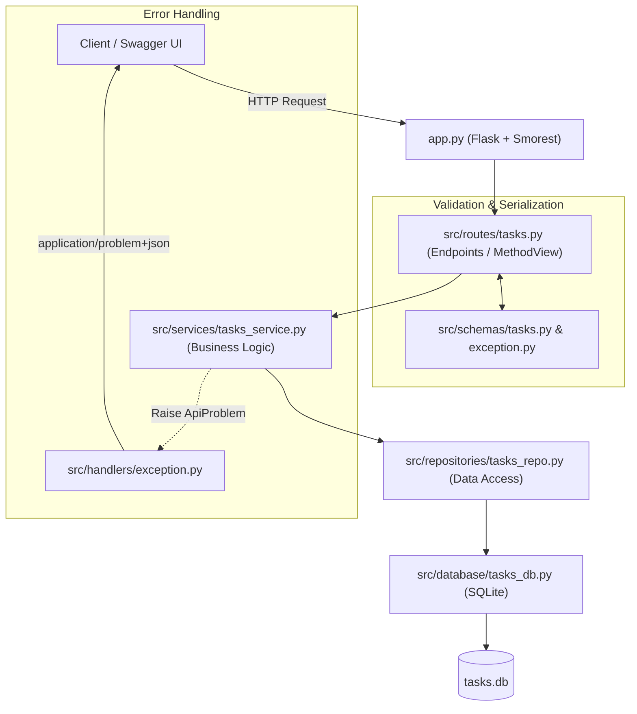

# Tuần 4: Thiết kế Đặc tả API (OpenAPI 3.0 & Swagger) và Triển khai Dịch vụ

Báo cáo bài tập môn **Kiến trúc Hướng Dịch vụ (SOA / API Design and Implementation)**. Dự án tập trung vào việc thiết kế đặc tả RESTful API chuẩn hóa theo chuẩn quốc tế **OpenAPI Specification (OAS 3.0.3)**, xử lý lỗi theo **RFC 7807 (Problem Details)** và xây dựng ứng dụng mẫu với kiến trúc phân tầng chuyên nghiệp sử dụng **Flask-Smorest**, **Marshmallow** và **SQLite**.

---

## Mục lục

1. [Tổng quan nội dung](#1-tổng-quan-nội-dung)
2. [Cấu trúc cây thư mục](#2-cấu-trúc-cây-thư-mục)
3. [Kiến trúc phân tầng (Layered Architecture)](#3-kiến-trúc-phân-tầng-layered-architecture)
4. [Bài 1: Đặc tả Petstore API (Swagger Editor)](#4-bài-1-đặc-tả-petstore-api-swagger-editor)
5. [Bài 2: Hệ thống Quản lý Công việc Nội bộ (Tasks API)](#5-bài-2-hệ-thống-quản-lý-công-việc-nội-bộ-tasks-api)
   - [5.1. Mô hình thực thể Task](#51-mô-hình-thực-thể-task)
   - [5.2. Danh sách 5 Endpoints](#52-danh-sách-5-endpoints)
   - [5.3. Kỹ thuật phân trang con trỏ (Keyset Cursor Pagination)](#53-kỹ-thuật-phân-trang-con-trỏ-keyset-cursor-pagination)
   - [5.4. Chuẩn hóa phản hồi lỗi theo RFC 7807](#54-chuẩn-hóa-phản-hồi-lỗi-theo-rfc-7807)
6. [Hướng dẫn cài đặt và vận hành](#6-hướng-dẫn-cài-đặt-và-vận-hành)
7. [Kịch bản kiểm thử mẫu với cURL](#7-kịch-bản-kiểm-thử-mẫu-với-curl)

---

## 1. Tổng quan nội dung

Tuần 4 giải quyết hai bài toán cốt lõi trong thiết kế giao tiếp dịch vụ:

- **Bài 1 — Petstore API Specification**: Xây dựng file đặc tả OpenAPI 3.0.3 cho dịch vụ quản lý thú cưng, chuẩn hóa toàn diện schema dữ liệu, các mã phản hồi HTTP (`200`, `201`, `204`, `400`, `404`, `500`) và cấu trúc lỗi RFC 7807 (`application/problem+json`).
- **Bài 2 — Tasks API Implementation**: Thiết kế hợp đồng API và hiện thực hóa dịch vụ quản lý công việc nội bộ bằng Python (Flask-Smorest), áp dụng kiến trúc phân tầng (Clean / Layered Architecture) tách biệt giữa Controller/Route, Service Logic, Data Repository và Database. Hệ thống hỗ trợ phân trang hiệu năng cao dạng Keyset Cursor Pagination, tự động sinh tài liệu Swagger UI và OpenAPI Specification.

---

## 2. Cấu trúc cây thư mục

```text
Week4/
├── petstore/
│   ├── pestore.yaml               # File đặc tả OpenAPI 3.0.3 cho Petstore API
│   └── petstore.yaml              # Bản sao chuẩn hóa tên gọi tiện tra cứu
│
├── tasks/                         # Ứng dụng Tasks API theo kiến trúc phân tầng
│   ├── app.py                     # Entrypoint khởi tạo Flask app & Swagger UI
│   ├── openapi.json               # OpenAPI Specification tự sinh (JSON format)
│   ├── taskApi.yaml               # OpenAPI Specification viết tay chuẩn xác (YAML)
│   ├── SwaggerUI.pdf              # Tài liệu minh họa kiểm thử qua Swagger UI
│   └── src/
│       ├── database/
│       │   ├── schemas.sql        # Kịch bản DDL tạo bảng tasks, index & seed data
│       │   └── tasks_db.py        # Module quản lý kết nối SQLite & hàm init_db()
│       ├── handlers/
│       │   └── exception.py       # Ngoại lệ ApiProblem & bộ bắt lỗi toàn cục RFC 7807
│       ├── repositories/
│       │   └── tasks_repo.py      # Tầng truy xuất CSDL (CRUD & Keyset query)
│       ├── routes/
│       │   └── tasks.py           # Presentation layer (Flask-Smorest Blueprint & MethodView)
│       ├── schemas/
│       │   ├── exception.py       # Marshmallow schema cho ProblemDetails (RFC 7807)
│       │   └── tasks.py           # Marshmallow schemas: Task, TaskInput, TaskUpdate, TaskList
│       └── services/
│           └── tasks_service.py   # Business logic: validate, phân trang cursor, serialize
│
├── requirements.txt               # Danh sách thư viện phụ thuộc
└── README.md                      # Báo cáo tổng quan dự án và hướng dẫn sử dụng
```

---

## 3. Kiến trúc phân tầng (Layered Architecture)

Mã nguồn dịch vụ Tasks API được tổ chức theo mô hình phân tách trách nhiệm (Separation of Concerns):



- **Routes (`src/routes`)**: Tiếp nhận request HTTP, kiểm tra hợp lệ kiểu dữ liệu bằng schema, gọi sang Service tương ứng và trả về phản hồi mã HTTP.
- **Schemas (`src/schemas`)**: Định nghĩa hợp đồng dữ liệu thông qua thư viện `marshmallow`, hỗ trợ xác thực đầu vào và định dạng đầu ra.
- **Services (`src/services`)**: Xử lý logic nghiệp vụ, giải mã/mã hóa con trỏ phân trang (Cursor), lọc và sắp xếp.
- **Repositories (`src/repositories`)**: Trừu tượng hóa các câu lệnh SQL (`SELECT`, `INSERT`, `UPDATE`, `DELETE`) với tham số hóa (Parameterized Queries) chống SQL Injection.
- **Database (`src/database`)**: Kết nối tới file SQLite, thiết lập các chỉ mục (Indexes) nhằm tăng tốc độ truy vấn.
- **Handlers (`src/handlers`)**: Bắt mọi ngoại lệ và định dạng cấu trúc lỗi thống nhất theo RFC 7807.

---

## 4. Bài 1: Đặc tả Petstore API (Swagger Editor)

Tập tin đặc tả: [`petstore/pestore.yaml`](file:///c:/Users/Dang%20Tran%20Tien/OneDrive/Desktop/Week3/Week4/petstore/pestore.yaml)

File đặc tả tuân thủ **OpenAPI 3.0.3**, bao gồm các tài nguyên chính:

| HTTP Method | Endpoint | Mô tả | Mã phản hồi |
|:---:|:---|:---|:---:|
| `GET` | `/pets` | Lấy danh sách thú cưng (hỗ trợ query `limit`, `tag`) | `200`, `400`, `500` |
| `POST` | `/pets` | Tạo mới thú cưng với payload `NewPet` | `201`, `400`, `500` |
| `GET` | `/pets/{petId}` | Xem chi tiết thông tin thú cưng theo ID | `200`, `400`, `404`, `500` |
| `DELETE` | `/pets/{petId}` | Xóa vĩnh viễn thú cưng khỏi hệ thống | `204`, `404`, `500` |

Tất cả các mã lỗi `4xx` và `5xx` đều tham chiếu tới component `#/components/schemas/Error` theo đúng chuẩn Problem Details RFC 7807 (`application/problem+json`).

---

## 5. Bài 2: Hệ thống Quản lý Công việc Nội bộ (Tasks API)

### 5.1. Mô hình thực thể Task

Bản ghi công việc nội bộ bao gồm 6 trường dữ liệu cốt lõi:

| Trường | Kiểu dữ liệu | Bắt buộc | Ràng buộc / Định dạng | Ví dụ |
|:---|:---:|:---:|:---|:---|
| `id` | Integer | Tự sinh | Khóa chính tự tăng (`PRIMARY KEY AUTOINCREMENT`) | `1` |
| `title` | String | Có | Chiều dài từ 1 đến 255 ký tự | `"Triển khai xác thực JWT"` |
| `status` | String | Có | Enum: `todo`, `in_progress`, `done`, `cancelled` | `"in_progress"` |
| `priority` | String | Có | Enum: `low`, `medium`, `high`, `urgent` | `"high"` |
| `dueDate` | Date | Có | Định dạng chuẩn ISO-8601 `YYYY-MM-DD` | `"2026-03-31"` |
| `assignedID` | Integer | Có | Số nguyên dương định danh nhân viên phụ trách | `101` |

---

### 5.2. Danh sách 5 Endpoints

Tất cả các endpoint đều có tiền tố `/tasks`:

| Phương thức | Đường dẫn | Chức năng chi tiết | Trạng thái thành công |
|:---:|:---|:---|:---:|
| `GET` | `/tasks` | Lấy danh sách công việc có lọc đa điều kiện và phân trang con trỏ | `200 OK` |
| `POST` | `/tasks` | Tạo mới công việc với đầy đủ các trường bắt buộc | `201 Created` |
| `GET` | `/tasks/{task_id}` | Xem chi tiết một công việc theo mã `task_id` | `200 OK` |
| `PATCH` | `/tasks/{task_id}` | Cập nhật từng phần (Partial Update) các trường gửi lên | `200 OK` |
| `DELETE` | `/tasks/{task_id}` | Xóa công việc khỏi CSDL | `204 No Content` |

---

### 5.3. Kỹ thuật phân trang con trỏ (Keyset Cursor Pagination)

Thay vì sử dụng phân trang truyền thống `OFFSET / LIMIT` (vốn gây suy giảm hiệu năng $O(N)$ khi dữ liệu lớn và dễ bị trùng/nhảy bản ghi khi có thêm/xóa dữ liệu), dịch vụ sử dụng **Keyset Pagination**:

1. **Cấu trúc Cursor**: Là một chuỗi Base64 (URL-safe) chứa thông tin của bản ghi cuối cùng của trang trước:
   ```json
   {
     "sort": "id",
     "val": "10",
     "id": 10
   }
   ```
2. **Cơ chế truy vấn**: Khi client gửi `cursor=eyJzb3J0IjoiaWQiLCJ2YWwiOiIxMCIsImlkIjoxMH0`, hệ thống giải mã và chèn điều kiện lọc tối ưu chỉ mục:
   ```sql
   WHERE (id > 10) ORDER BY id ASC LIMIT 11;
   ```
3. **Phản hồi**: Trường `next_cursor` sẽ trả về `null` khi đã duyệt hết toàn bộ dữ liệu (`has_more = false`).

---

### 5.4. Chuẩn hóa phản hồi lỗi theo RFC 7807

Tất cả các lỗi trả về từ API đều có Header `Content-Type: application/problem+json` với cấu trúc JSON chuẩn mực:

```json
{
  "type": "https://httpstatuses.com/404",
  "title": "Task Not Found",
  "status": 404,
  "detail": "Không tìm thấy công việc với ID = 999.",
  "instance": "/tasks/999",
  "trace_id": "4a25c77c-a49e-4ff6-9b51-3801f9bb9739"
}
```

- `type`: URI phân loại định danh lỗi.
- `title`: Tóm tắt ngắn gọn loại sự cố.
- `status`: Mã trạng thái HTTP.
- `detail`: Diễn giải nguyên nhân sự cố cụ thể cho người dùng/lập trình viên.
- `instance`: Đường dẫn API xảy ra lỗi.
- `trace_id`: Mã UUID hỗ trợ tra cứu nhật ký (log tracing) trên hệ thống.

---

## 6. Hướng dẫn cài đặt và vận hành

### Bước 1: Chuẩn bị môi trường & cài đặt thư viện

Yêu cầu **Python 3.10+**. Cài đặt các gói phụ thuộc cần thiết:

```bash
pip install -r requirements.txt
```

### Bước 2: Khởi động máy chủ API

Bạn có thể chạy trực tiếp từ thư mục `Week4`:

```bash
python -m tasks.app
```

*Hoặc di chuyển vào thư mục `tasks` để chạy:*

```bash
cd tasks
python app.py
```

Khi khởi động lần đầu, hệ thống sẽ **tự động kiểm tra và tạo cơ sở dữ liệu SQLite** `tasks/src/database/tasks.db` kèm 15 bản ghi mẫu phong phú.

### Bước 3: Trải nghiệm Swagger UI

- **Giao diện Swagger UI tương tác**: Mở trình duyệt tại [http://127.0.0.1:5000/docs](http://127.0.0.1:5000/docs) (Hệ thống tự động chuyển hướng nếu truy cập trang chủ `http://127.0.0.1:5000/`).
- **OpenAPI Schema (JSON)**: [http://127.0.0.1:5000/openapi.json](http://127.0.0.1:5000/openapi.json).

---

## 7. Kịch bản kiểm thử mẫu với cURL

#### 1. Lấy trang đầu tiên (5 công việc, lọc trạng thái `in_progress`):
```bash
curl -X GET "http://127.0.0.1:5000/tasks?limit=5&status=in_progress" -H "Accept: application/json"
```

#### 2. Lấy trang kế tiếp sử dụng `cursor`:
```bash
curl -X GET "http://127.0.0.1:5000/tasks?limit=5&cursor=<NEXT_CURSOR_STRING>" -H "Accept: application/json"
```

#### 3. Tạo mới một công việc:
```bash
curl -X POST "http://127.0.0.1:5000/tasks" \
  -H "Content-Type: application/json" \
  -d '{
    "title": "Tích hợp xác thực OAuth2 cho hệ thống",
    "status": "todo",
    "priority": "high",
    "dueDate": "2026-04-30",
    "assignedID": 102
  }'
```

#### 4. Cập nhật một phần (PATCH):
```bash
curl -X PATCH "http://127.0.0.1:5000/tasks/1" \
  -H "Content-Type: application/json" \
  -d '{
    "status": "done",
    "priority": "urgent"
  }'
```

#### 5. Xóa công việc:
```bash
curl -X DELETE "http://127.0.0.1:5000/tasks/1" -i
```
*(Kết quả trả về HTTP 204 No Content)*

#### 6. Kiểm tra phản hồi lỗi chuẩn RFC 7807 (khi truy vấn ID không tồn tại):
```bash
curl -X GET "http://127.0.0.1:5000/tasks/99999" -i
```
